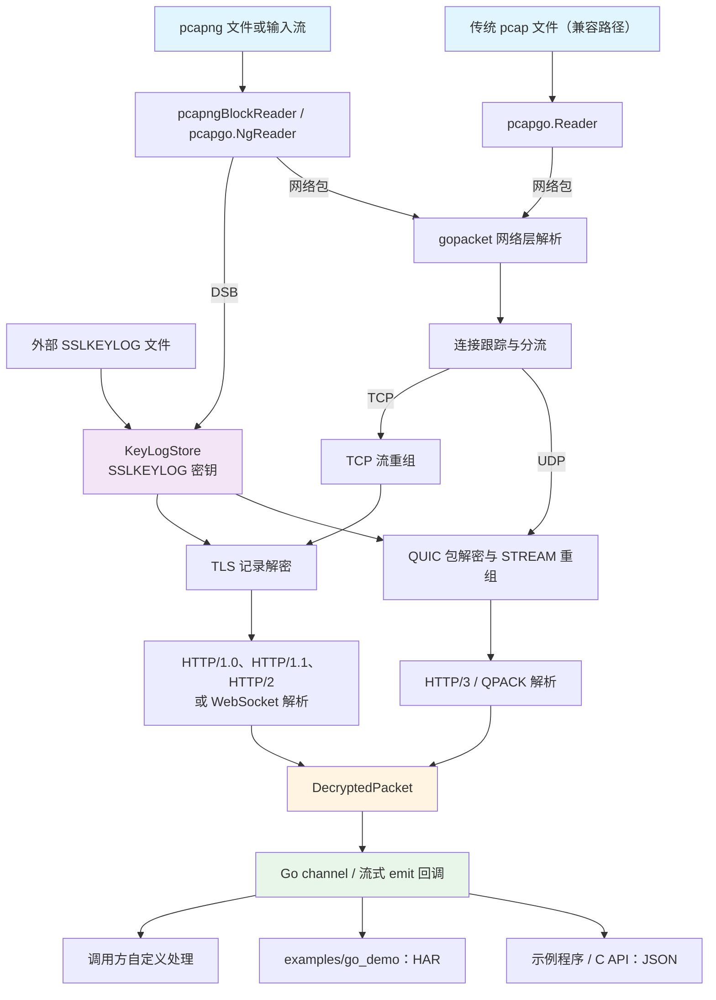
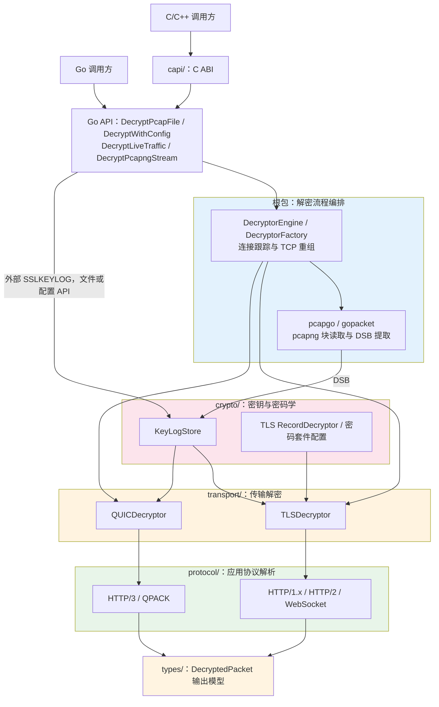

# eCapture Decryptor - TLS/QUIC 流量解密库

一个使用 SSLKEYLOG 解密 pcapng 中 TLS/QUIC 流量的 Go 语言库。密钥可来自独立的 SSLKEYLOG 文件，也可来自 pcapng 内嵌的 TLS Decryption Secrets Block（DSB）。

仓库名为 `ecapture_decryptor`，Go 模块路径为 `github.com/gojue/ecapture_decryptor`；根包、C 库文件和发布压缩包沿用 `ecapture_decryptor`。

## ✨ 特性

- 🔓 **解密 TLS/QUIC 流量**：支持外部 SSLKEYLOG 文件和 pcapng 内嵌 DSB
- 🌐 **多协议支持**：HTTP/1.0、HTTP/1.1、HTTP/2、HTTP/3、WebSocket
- 📦 **灵活输出**：输出 `DecryptedPacket` 结构，用户可自由处理
- 🔧 **多种使用方式**：Go 库、静态链接库（.a）、命令行工具
- 🎯 **职责清晰**：只负责解密和协议解析，不强制输出格式

### QUIC / HTTP/3 输入要求

解密 HTTP/3 需要包含客户端 Initial（其中有 ClientHello）的双向 UDP 抓包，
以及匹配该连接的 TLS 1.3 SSLKEYLOG。密钥可作为外部文件传入，也可放在
pcapng 的 DSB 中。解析器按 QUIC 连接、包号和 STREAM 偏移重组数据，再按
HTTP/3 请求流输出 `http/3` 的 `DecryptedPacket`。

仓库中的 [Linux HTTP/3 抓包](test/fixtures/http3_capture/README.md)由 `tcpdump` 和
eCapture 实际捕获，分别覆盖回环地址 `127.0.0.1:44433` 与公网域名
`www.cloudflare.com:443`，可验证外部密钥、内嵌 DSB 和 DSB 文件的流式读取。
当前端到端测试覆盖 QUIC v1；v2 和 draft-29 的密钥派生已实现，但尚无真实抓包测试。
HTTP/3 头部解析支持 QPACK 静态表和字面量；使用动态表的连接暂不支持。
QUIC 密钥更新和连接迁移尚未覆盖。

[Linux HTTP/1.x 与 HTTP/2 抓包](test/fixtures/http_tcp_capture/README.md)覆盖
HTTP/1.0 关闭连接定界响应、HTTP/1.1 长连接及双向分块传输、HTTP/2 多路复用；
每个场景都有 tcpdump 外部 SSLKEYLOG 和 eCapture 内嵌 DSB 样本。

## 🚀 快速开始

### pcapng 文件解密

`DecryptPcapFile` 的 `keylogReader` 可以为 `nil`，此时从 pcapng 的 DSB 读取密钥；传入 SSLKEYLOG 文件读取器时，也会读取 pcapng 中的 DSB。两个来源可以同时使用。

```go
// 仅使用 pcapng 内嵌的 DSB。
err := ecapture_decryptor.DecryptPcapFile(nil, pcapngFile, packetChan)

// 使用外部 SSLKEYLOG 文件；pcapng 内若有 DSB 也会一并加载。
err = ecapture_decryptor.DecryptPcapFile(keylogFile, pcapngFile, packetChan)
```

### 增量 pcapng + DSB 解密

`DecryptPcapngStream(ctx, input, emit)` 从持续增长的 pcapng `io.ReadCloser`
读取完整块，并在 DSB 到达时立即加载 NSS Key Log 密钥。DSB 可以晚于握手、
应用数据，甚至最后一个网络包。SDK 按 TCP 序号重组、去重，并输出完整的
HTTP/1.1 或 HTTP/2 请求/响应；`emit` 返回错误会停止读取并返回该错误。
取消 `ctx` 会关闭 `input`，以解除阻塞读取。调用方应按需给 `input` 配置
能够被 `Close` 中断的实现，例如 `io.PipeReader` 或网络连接。

```go
err := ecapture_decryptor.DecryptPcapngStream(ctx, input, func(message *types.DecryptedPacket) error {
    // message.Data 是完整 HTTP 消息；Metadata 包含 host / authority 和 stream_id。
    return handle(message)
})
```

eCapture 集成及其源码和二进制分发（含商业使用）适用
[LICENSE](LICENSE) 中的 **eCapture Integration Exception**。其他 SDK 用途
仍按原有授权条款处理。

### 安装

```bash
go get github.com/gojue/ecapture_decryptor
```

### 基本使用

```go
package main

import (
    "log"
    "os"
    
    "github.com/gojue/ecapture_decryptor"
    "github.com/gojue/ecapture_decryptor/types"
)

func main() {
    // 打开文件
    keylog, _ := os.Open("sslkey.log")
    pcap, _ := os.Open("traffic.pcap")
    defer keylog.Close()
    defer pcap.Close()
    
    // 创建 channel 接收解密的包
    packetChan := make(chan *types.DecryptedPacket, 100)
    
    // 处理解密的包
    go func() {
        for packet := range packetChan {
            log.Printf("[%s] %s: %d bytes", 
                packet.Protocol,    // "http/1.1", "http/2", etc.
                packet.Direction,   // "request" or "response"
                len(packet.Data))   // 解密后的数据
        }
    }()
    
    // 解密
    err := ecapture_decryptor.DecryptPcapFile(keylog, pcap, packetChan)
    if err != nil {
        log.Fatal(err)
    }
    
    close(packetChan)
}
```

## 📦 构建

```bash
# 构建 Go 命令行示例
make -C examples/go_demo build

# 构建静态链接库 (.a 文件，供 C/C++ 使用)
make build-static

# 构建动态链接库
make build-shared

# 构建 C 示例程序（使用静态库）
make -C examples/c_demo all

# 清理
make clean
```

构建产物：
- `bin/ecapture_decryptor` - 命令行工具（Go）
- `lib/libecapture_decryptor.a` - 静态链接库
- `lib/libecapture_decryptor.dylib` 或 `.so` - 动态链接库
- `include/libecapture_decryptor.h` - C 头文件
- `bin/offline_decryption` - C 离线解密示例
- `bin/stream_decryption` - C 流式解密示例
- `bin/live_capture_simple` - C 实时捕获示例

### 📉 体积优化

默认构建已应用以下优化（减少 30-40% 体积）：
- `-s -w`: 去除符号表和调试信息
- `-trimpath`: 去除文件系统路径

## 🎯 命令行使用

```bash
# 使用外部 SSLKEYLOG 文件
./bin/ecapture_decryptor \
  -pcap traffic.pcapng \
  -sslkeylog sslkey.log \
  -v

# 使用 pcapng 内嵌的 DSB
./bin/ecapture_decryptor -pcap traffic-with-dsb.pcapng -json output.json

# 保存为 HAR 格式
./bin/ecapture_decryptor \
  -pcap traffic.pcapng \
  -sslkeylog sslkey.log \
  -har output.har

# 保存为 JSON 格式
./bin/ecapture_decryptor \
  -pcap traffic.pcapng \
  -sslkeylog sslkey.log \
  -json output.json
```

## 📊 DecryptedPacket 结构

```go
type DecryptedPacket struct {
    Protocol     string                 // 协议: "http/1.1", "http/2", "http/3", "websocket"
    Direction    string                 // 方向: "request" 或 "response"
    Data         []byte                 // 解密后的应用层数据
    Timestamp    time.Time              // 数据包时间戳
    ConnectionID string                 // 连接标识符
    Metadata     map[string]interface{} // 协议特定元数据
}
```

### 元数据示例

**HTTP/1.1 Request:**
```go
{
    "method": "GET",
    "url": "https://example.com/path",
    "headers": http.Header{...}
}
```

**HTTP/2:**
```go
{
    "stream_id": 1,
    "method": "GET",
    "path": "/path",
    "headers": http.Header{...}
}
```

## 🔧 API 参考

### 核心函数

#### DecryptPcapFile
解密 pcap/pcapng 文件中的流量

```go
func DecryptPcapFile(
    keylogReader io.Reader,      // SSLKEYLOG 文件
    pcapFileHandle io.Reader,    // PCAP 文件
    packetChan chan *types.DecryptedPacket, // 输出 channel
) error
```

#### DecryptLiveTraffic
解密实时流量（从网卡或实时 pcap 流）

```go
func DecryptLiveTraffic(
    keylogReader io.Reader,      // SSLKEYLOG 文件
    pcapHandle io.Reader,        // 实时 pcap 流
    packetChan chan *types.DecryptedPacket, // 输出 channel
) error
```

## 🔗 C/C++ 静态库使用

`capi/main.go` 是 SDK 的 C ABI 实现，会被编译成库和头文件；`examples/c_demo` 中的程序是该接口的调用示例。

### 构建静态库

```bash
make build-static
```

这将生成：
- `lib/libecapture_decryptor.a` - 静态库
- `include/libecapture_decryptor.h` - C 头文件

### C API 函数

#### 离线解密
- `GetVersion()` - 获取库版本
- `DecryptPcapToFile()` - 解密 pcapng 文件到 JSON；keylogPath 传空字符串或 NULL 时使用内嵌 DSB
- `FreeString()` - 释放 Go 分配的字符串

#### 实时/流式解密
- `DecryptPcapStreamToFile()` - 从 stdin 解密 pcap/pcapng 流（可用于管道）；不提供 keylogPath 时使用 pcapng DSB
- `DecryptLiveTrafficToFile()` - 启动实时流量解密（非阻塞）
- `StopLiveTraffic()` - 停止实时流量解密
- `GetLiveTrafficError()` - 获取实时会话错误信息

### C 程序示例

#### 1. 离线解密

```c
#include "libecapture_decryptor.h"
#include <stdio.h>

int main() {
    char errorBuf[256] = {0};
    int ret = DecryptPcapToFile(
        "./traffic.pcap",
        "./sslkey.log",
        "./output.json",
        "json",
        errorBuf,
        sizeof(errorBuf)
    );
    
    if (ret != 0) {
        fprintf(stderr, "Decryption failed: %s\n", errorBuf);
        return 1;
    }
    
    printf("Success!\n");
    return 0;
}
```

#### 2. 流式解密（从管道）

```c
// 从 tcpdump 管道读取并解密
// 用法: tcpdump -i eth0 -w - | ./stream_decrypt sslkey.log output.json

int main(int argc, char *argv[]) {
    char errorBuf[256] = {0};
    int ret = DecryptPcapStreamToFile(
        argv[1],  // keylog path
        argv[2],  // output path
        0,        // maxPackets (0 = unlimited)
        errorBuf,
        sizeof(errorBuf)
    );
    
    if (ret != 0) {
        fprintf(stderr, "Stream decryption failed: %s\n", errorBuf);
        return 1;
    }
    
    return 0;
}
```

#### 3. 实时流量捕获

```c
// 启动实时捕获 30 秒
int handle = DecryptLiveTrafficToFile(
    "en0",          // 网卡名称
    "sslkey.log",   // keylog 文件
    "output.json",  // 输出文件
    errorBuf,
    sizeof(errorBuf)
);

if (handle > 0) {
    sleep(30);  // 捕获 30 秒
    StopLiveTraffic(handle);
}
```

### 完整 C 示例程序

项目包含完整的 C 示例程序，演示了所有功能：

```bash
# 构建 C 示例程序
make -C examples/c_demo all

# 运行测试
cd examples/c_demo
make test

# 离线解密
./offline_decryption traffic.pcap sslkey.log output.json

# 流式解密（从文件）
cat traffic.pcap | ./stream_decryption sslkey.log output.json

# 流式解密（从 tcpdump）
tcpdump -i eth0 -w - | ./stream_decryption sslkey.log output.json

# 实时捕获（API 演示）
./live_capture_simple en0 sslkey.log output.json 30
```

查看 `examples/c_demo/README.md` 获取详细说明。


### 编译 C/C++ 程序

```bash
# Linux/macOS
gcc -o myapp myapp.c \
    -I./bin -L./bin \
    -lecapture_decryptor \
    -lpthread -lresolv

# C++
g++ -o myapp myapp.cpp \
    -I./bin -L./bin \
    -lecapture_decryptor \
    -lpthread -lresolv
```

**详细文档**: 查看 [docs/CAPI_USAGE.md](docs/CAPI_USAGE.md) 获取完整的 C API 使用说明。

## 📝 示例程序

项目包含完整的示例程序，展示如何：
- 解密流量并输出统计信息
- 将解密结果转换为 HAR 格式
- 将解密结果保存为 JSON

查看 `examples/` 目录获取更多示例。

## 🏗️ 架构

### 数据流架构



核心 SDK 输出 `DecryptedPacket`；HAR 与 JSON 由调用方或示例程序生成。
`DecryptPcapFile` 支持传统 pcap 文件，并从外部 SSLKEYLOG 获取密钥。
`DecryptPcapngStream` 使用输入流中的 DSB，`DecryptLiveTraffic` 接受调用方提供的抓包流。

### 分层架构



## 📚 文档

### 核心文档
- **[CHANGELOG.md](CHANGELOG.md)** - 版本变更历史
- **[快速开始](#-快速开始)** - 使用示例（见上方）

### 技术文档 (在 docs/ 目录)
- **[API 参考](docs/API.md)** - 完整 API 文档和使用指南
- **[架构设计](docs/ARCHITECTURE.md)** - 系统架构和设计原理
- **[开发指南](docs/DEVELOPMENT.md)** - 开发环境和贡献指南

### 构建和发布 (在 docs/ 目录)
- **[Makefile 指南](docs/MAKEFILE_GUIDE.md)** - 构建系统使用说明
- **[发布管理](docs/RELEASE_GUIDE.md)** - 版本发布完整流程
- **[发布快速参考](docs/RELEASE_QUICKREF.md)** - 常用发布命令
- **[发布示例](docs/RELEASE_EXAMPLES.md)** - 真实场景示例
- **[文档索引](docs/README.md)** - 完整文档导航

### 许可证文档
- **[LICENSE](LICENSE)** - 主许可证（中英文）
- **[LICENSE-BINARY](LICENSE-BINARY)** - 二进制库许可证（中英文）
- **[COPYRIGHT](COPYRIGHT)** - 版权声明
- **[许可摘要](docs/LICENSE-SUMMARY.md)** - 许可证快速参考

## 📄 许可证 / License

### ⚠️ 双重许可模式 / Dual License

本项目采用**双重许可模式**：

#### 1. 源代码许可 (Source Code License)

**版权所有 © 2024-2026 CFC4N (cfc4n.cs@gmail.com)。保留所有权利。**

源代码为**专有软件**，未经明确书面许可，**禁止任何形式的使用、复制、修改或分发**。

查看源代码不授予任何使用权限。

#### 2. 二进制库许可 (Binary Library License)

**版权所有 © 2024-2026 CFC4N (cfc4n.cs@gmail.com)。保留所有权利。**

编译后的二进制库（.a, .so, .dylib）可用于**非商业用途**：

✅ **允许**：
- 个人使用
- 研究和教育用途
- 评估和测试
- 与非商业应用程序链接

❌ **禁止**：
- 商业使用（需要单独商业许可）
- 反向工程、反编译或修改
- 破解或规避功能
- 重新分发修改版本
- 删除版权声明

📝 **必需**：
- 保留所有版权声明
- 在您的应用程序中提供署名
- 包含许可证文件

#### 署名要求 / Attribution

使用本库时，必须包含以下署名：

```
本软件使用 eCapture Decryptor 库
版权所有 (c) 2024-2026 CFC4N (cfc4n.cs@gmail.com)
授权用于非商业用途
https://github.com/gojue/ecapture_decryptor
```

#### 商业许可 / Commercial License

如需商业使用，请联系：
- **邮箱**: cfc4n.cs@gmail.com
- **主题**: "Commercial License Inquiry - eCapture Decryptor"

#### 详细许可条款 / Detailed Terms

- [LICENSE](LICENSE) - 完整许可证（中英文）
- [LICENSE-BINARY](LICENSE-BINARY) - 二进制库详细许可（中英文）
- [COPYRIGHT](COPYRIGHT) - 版权声明

## 🤝 贡献

由于源代码为专有软件，暂不接受外部贡献。

如有问题或建议，欢迎提交 Issue。

## 🙏 致谢

本项目基于以下优秀的开源项目：
- [gopacket](https://github.com/google/gopacket) - 数据包处理
- Go 标准库的 crypto/tls 包

---

**⚠️ 重要提示**：
1. 使用本工具需要有合法的 SSLKEYLOG 文件
2. 请确保你有权限解密目标流量
3. 遵守所有适用的法律法规
4. 商业使用需要获得单独授权

**Copyright © 2024-2026 CFC4N. All Rights Reserved.**


