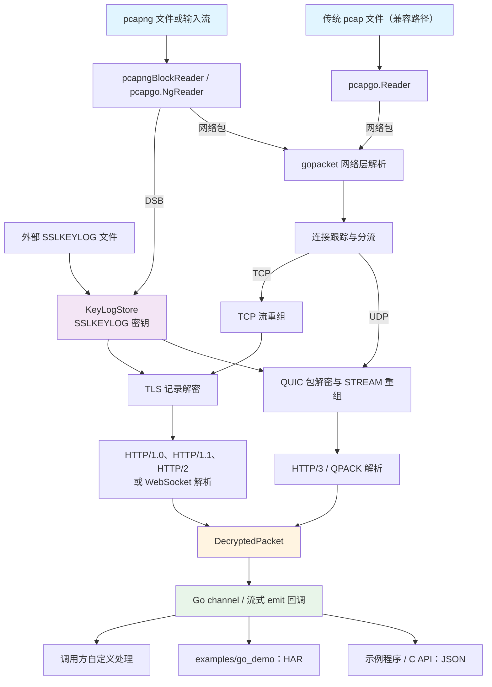
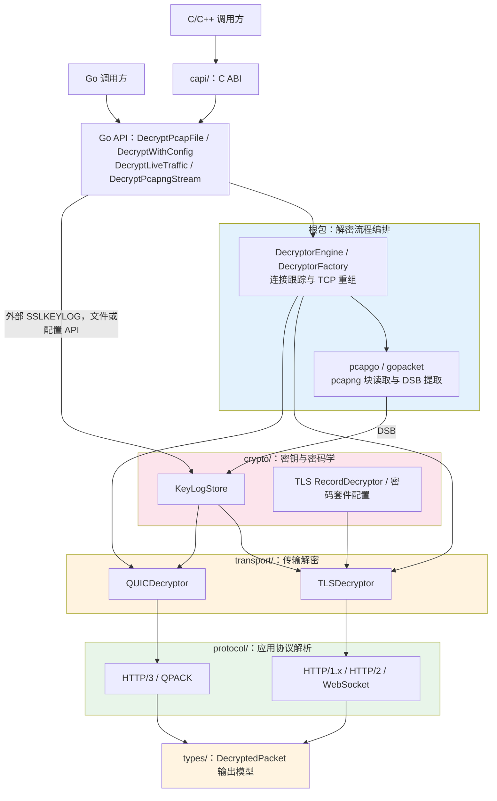

# Architecture - 架构设计文档

本文档描述 ecapture_decryptor 的系统架构和设计原理。

## 📐 架构概览

ecapture_decryptor 采用**分层架构**设计，每层职责清晰，模块解耦。

```
┌─────────────────────────────────────────────────────────────┐
│                     Application Layer                       │
│                      应用程序层                              │
├─────────────────────────────────────────────────────────────┤
│              Public API (api.go)                            │
│              公开 API 接口                                   │
├─────────────────────────────────────────────────────────────┤
│         Protocol Parser Layer (protocol/)                   │
│         协议解析层 - HTTP/1.1, HTTP/2, HTTP/3, WS          │
├─────────────────────────────────────────────────────────────┤
│       Transport Layer Decryption (transport/)               │
│       传输层解密 - TLS 1.2/1.3, QUIC                        │
├─────────────────────────────────────────────────────────────┤
│         Cryptography Layer (crypto/)                        │
│         密码学层 - 密钥管理、加密算法                        │
├─────────────────────────────────────────────────────────────┤
│          Packet Capture (gopacket)                          │
│          数据包捕获和解析                                    │
└─────────────────────────────────────────────────────────────┘
```

---

## 🔄 架构图

### 数据流架构



核心 SDK 输出 `DecryptedPacket`；HAR 与 JSON 由调用方或示例程序生成。
`DecryptPcapFile` 支持传统 pcap 文件，并从外部 SSLKEYLOG 获取密钥。
`DecryptPcapngStream` 使用输入流中的 DSB，`DecryptLiveTraffic` 接受调用方提供的抓包流。

### 分层架构



---

## 🏗️ 模块设计

### 1. 公开 API 层

**位置**: `api.go`, `factory.go`

**职责**:
- 提供简洁的公开接口
- 管理解密器生命周期
- 协调各层模块

**核心组件**:

```go
// api.go 中的公开签名
func DecryptPcapFile(keylog, pcap io.Reader, output chan *types.DecryptedPacket) error
func DecryptLiveTraffic(keylog, pcap io.Reader, output chan *types.DecryptedPacket) error
func NewDecryptorConfig() *DecryptorConfig
func DecryptWithConfig(config *DecryptorConfig) error
```

配置链式方法和流式入口见 [API 文档](API.md)。`DecryptLiveTraffic` 读取调用方
传入的 reader，本身不打开网卡。channel 需要并发消费，由调用方在解密返回后关闭。

**设计模式**:
- **Builder 模式**: `DecryptorConfig` 使用链式调用构建配置
- **Factory 模式**: `DecryptorFactory` 按需创建解密器实例

---

### 2. 协议解析层

**位置**: `protocol/`

**职责**:
- 解析应用层协议
- 提取协议元数据
- 重组分片消息

**模块结构**:

```
protocol/
├── protocol_registry.go      # 协议注册中心
├── http_stream.go            # HTTP/1.1 流解析器
├── protocol_http2.go         # HTTP/2 帧解析器
├── protocol_http3.go         # HTTP/3 (QUIC+QPACK) 解析器
└── protocol_websocket.go     # WebSocket 消息解析器
```

**核心接口**:

```go
// types/interfaces.go
type StreamParserInterface interface {
    FeedRequest(data []byte)
    FeedResponse(data []byte)
    SetPacketTime(t time.Time)
    Flush()
}

type ProtocolDetector interface {
    Name() string
    Detect(data []byte) int
    CreateParser(addr ConnectionKey, packetChan chan *DecryptedPacket) StreamParserInterface
}

// protocol/protocol_registry.go
func RegisterProtocol(detector types.ProtocolDetector)
func DetectProtocol(data []byte, ci types.ConnectionKey, packetChan chan *types.DecryptedPacket) (types.StreamParserInterface, string)
```

自动检测选择最高正分，由检测器为每条连接创建独立解析器。解析器按方向接收
解密字节，通过 channel 输出消息。`SelectProtocol` 支持已有协议的显式选择；
HTTP/3 由 QUIC 路径创建解析器，不能将其当成普通 TLS 字节前缀检测。

**协议识别流程**:

```
┌──────────────┐
│ 解密数据      │
└──────┬───────┘
       │
       ▼
┌──────────────────┐
│ 协议识别          │
│ - HTTP/1.x        │  请求方法前缀
│ - HTTP/2         │  客户端连接 preface
│ - WebSocket      │  HTTP Upgrade 协商
│ - HTTP/3         │  独立 QUIC 路径
└──────┬───────────┘
       │
       ▼
┌──────────────────┐
│ 选择解析器        │
└──────┬───────────┘
       │
       ▼
┌──────────────────┐
│ 解析并提取元数据  │
└──────┬───────────┘
       │
       ▼
┌──────────────────┐
│ 输出解密包        │
└──────────────────┘
```

---

### 3. 传输层解密

**位置**: `transport/`

**职责**:
- TLS 1.2/1.3 解密
- QUIC 解密
- 连接状态管理

**模块结构**:

```
transport/
├── adapters.go           # 适配器接口
├── tlsdecryptor.go       # TLS 解密器
├── tls_wrapper.go        # TLS 包装器
└── quic_decryptor.go     # QUIC 解密器
```

**核心接口**:

```go
// 解密器接口 (types/interfaces.go)
type Decryptor interface {
    Decrypt() error
    FeedClient(data []byte) error
    FeedServer(data []byte) error
    SetPacketTime(t time.Time)
    CloseClient() error
    CloseServer() error
    Close() error
    GetAddr() ConnectionKey
}

// factory.go 中的具体工厂方法，不是另一个接口
func (f *DecryptorFactory) Create(key types.ConnectionKey) types.Decryptor
```

**TLS 解密流程**:

```
┌─────────────────┐
│ TCP 数据包       │
└────────┬────────┘
         │
         ▼
┌─────────────────────┐
│ 识别 TLS 握手        │
│ - ClientHello       │
│ - ServerHello       │
│ - ChangeCipherSpec  │
└────────┬────────────┘
         │
         ▼
┌─────────────────────┐
│ 从 KeyLog 查找密钥  │
│ - CLIENT_RANDOM     │
│ - 客户端/服务器密钥  │
└────────┬────────────┘
         │
         ▼
┌─────────────────────┐
│ 解密 TLS 记录        │
│ - 计算 IV/Nonce     │
│ - AES-GCM/ChaCha20  │
│ - 验证 MAC          │
└────────┬────────────┘
         │
         ▼
┌─────────────────────┐
│ 输出明文数据         │
└─────────────────────┘
```

**QUIC 解密流程**:

```
┌─────────────────┐
│ UDP 数据包       │
└────────┬────────┘
         │
         ▼
┌─────────────────────┐
│ 解析 QUIC 头部       │
│ - Long Header       │
│ - Short Header      │
│ - Packet Number     │
└────────┬────────────┘
         │
         ▼
┌─────────────────────┐
│ 从 KeyLog 查找密钥  │
│ - TLS 1.3 secrets   │
│ - 按 ClientRandom   │
└────────┬────────────┘
         │
         ▼
┌─────────────────────┐
│ 解密 QUIC Payload   │
│ - 头部保护移除       │
│ - Payload 解密      │
└────────┬────────────┘
         │
         ▼
┌─────────────────────┐
│ 重组 QUIC 帧         │
│ - STREAM 帧         │
│ - CRYPTO 帧         │
└────────┬────────────┘
         │
         ▼
┌─────────────────────┐
│ 输出 HTTP/3 数据     │
└─────────────────────┘
```

---

### 4. 密码学层

**位置**: `crypto/`

**职责**:
- 密钥管理
- 加密算法实现
- 握手信息解析

**模块结构**:

```
crypto/
├── keylog.go             # SSLKEYLOG 解析和存储
├── cipher_registry.go    # 密码套件注册
├── decryptor.go          # 通用解密器
├── handshake.go          # TLS 握手解析
└── stream.go             # TLS 输入记录缓冲
```

**密钥管理**:

[`crypto.KeyLogStore`](../crypto/keylog.go) 按 ClientRandom 索引 `TLSSecrets`，
由 `NewKeyLogStoreFromReader`、`LoadFromReader` 或增量 `Write` 导入 keylog。
TLS 1.2 使用 `MasterSecret`，TLS 1.3/QUIC 使用按方向及阶段区分的 traffic secrets；
ECH 关联材料按 OuterRandom 保存。存储有锁、导入上限和更新通知，迟到 DSB 可唤醒
等待方，不需要伪造下一包。密钥派生后的记录/包状态由对应解密器持有。

**支持的密码套件**:

| 密码套件 | TLS 版本 | 算法 | 支持状态 |
|---------|---------|------|---------|
| TLS_AES_128_GCM_SHA256 | 1.3 | AES-128-GCM | ✅ |
| TLS_AES_256_GCM_SHA384 | 1.3 | AES-256-GCM | ✅ |
| TLS_CHACHA20_POLY1305_SHA256 | 1.3 | ChaCha20 | ✅ |
| TLS_ECDHE_RSA_WITH_AES_128_GCM_SHA256 | 1.2 | AES-128-GCM | ✅ |
| TLS_ECDHE_RSA_WITH_AES_256_GCM_SHA384 | 1.2 | AES-256-GCM | ✅ |

这里只列部分已注册套件；注册不等于所有握手/恢复/更新组合均可用。
实际版本和状态边界见 [API 能力矩阵](API.md)。

---

### 5. 数据类型层

**位置**: `types/`

**职责**:
- 定义公共接口
- 定义数据结构
- 提供类型转换

**核心类型**:

`types.DecryptedPacket` 的完整定义和构造函数见 [`types/packet.go`](../types/packet.go)。
`Data` 为解密字节且带 `json:"-"`，直接 JSON 编码不携带正文；连接身份由
`ConnectionID()` 取得，不应仅按可见端点字段拼接。

```go
// types/interfaces.go 中的连接标识
type ConnectionKey struct {
    SrcIP       net.IP
    DstIP       net.IP
    SrcPort     uint16
    DstPort     uint16
    Proto       string
    Pid         int
    FD          int
    ProcessName string
    Generation  uint64
}
```

---

## 🔄 数据流

### 完整数据流

```
┌──────────────┐
│ PCAP 文件     │
└──────┬───────┘
       │
       ▼
┌──────────────────┐
│ gopacket 解析     │
│ - Ethernet       │
│ - IP             │
│ - TCP/UDP        │
└──────┬───────────┘
       │
       ▼
┌──────────────────┐
│ 连接跟踪          │
│ - 创建连接        │
│ - 查找解密器      │
└──────┬───────────┘
       │
       ▼
┌──────────────────┐
│ 传输层解密        │
│ - TLS/QUIC       │
└──────┬───────────┘
       │
       ▼
┌──────────────────┐
│ 协议识别          │
│ - HTTP/1.1       │
│ - HTTP/2         │
│ - HTTP/3         │
│ - WebSocket      │
└──────┬───────────┘
       │
       ▼
┌──────────────────┐
│ 协议解析          │
│ - 提取元数据      │
│ - 重组消息        │
└──────┬───────────┘
       │
       ▼
┌──────────────────┐
│ 输出通道          │
│ DecryptedPacket  │
└──────────────────┘
```

### 连接管理

[`api.go`](../api.go) 负责双向路由及解密器创建；TCP 先经过
[`tcp_reassembly.go`](../tcp_reassembly.go) 的序号重组和重传去重，再按方向调用
`FeedClient`/`FeedServer`。同 tuple 的新 SYN 使用新的 `Generation`，重复 SYN
不创建新连接。QUIC 路由还需要 CID 状态，不能用简单的单向 tuple map 替代。
空闲回收、关闭和连接额度释放见 [`lifecycle.go`](../lifecycle.go)。

---

## 🎯 设计原则

### 1. 单一职责原则 (SRP)

每个模块只负责一个功能：
- `crypto/` 只负责密码学操作
- `transport/` 只负责传输层解密
- `protocol/` 只负责协议解析

### 2. 开闭原则 (OCP)

- 新增字节流协议：实现 `types.StreamParserInterface` 及 `types.ProtocolDetector`，
  调用 `protocol.RegisterProtocol(detector)`。
- 新增密码套件：核对 `crypto.CipherSuiteConfig`，调用 `crypto.RegisterCipherSuite`；
  需要新记录布局或算法时，还需实现相应解密路径。
- 注册表复用现有创建流程；新增传输或公开选项仍需修改路由和选项校验。

具体步骤见 [开发指南](DEVELOPMENT.md#添加新的协议解析器)，此处不另定义一套解析接口。

### 3. 依赖倒置原则 (DIP)

- 高层模块不依赖低层模块，都依赖抽象
- 使用 `types.Decryptor`、`types.ProtocolDetector` 和 `types.StreamParserInterface`
  连接引擎、解密器和应用解析器；真实签名见前文及 `types/interfaces.go`。

### 4. 接口隔离原则 (ISP)

- 接口小而专注
- 客户端不依赖不需要的接口

检测器负责识别与创建，流解析器负责分方向输入、时间戳和 Flush；HAR/JSON 导出
留在调用方或示例，不并入解析器接口。

---

## 🔧 关键技术

### 1. TLS 记录解密

```
TLS Record 结构:
┌────────────────────────┐
│ Type (1 byte)          │ 记录类型
├────────────────────────┤
│ Version (2 bytes)      │ TLS 版本
├────────────────────────┤
│ Length (2 bytes)       │ 数据长度
├────────────────────────┤
│ Encrypted Data         │ 加密数据
│ + Auth Tag             │ + 认证标签
└────────────────────────┘

解密过程:
1. 提取 Nonce = IV ^ SequenceNumber
2. AAD = Type + Version + Length
3. Plaintext = AES_GCM_Decrypt(Key, Nonce, Ciphertext, AAD)
```

### 2. HTTP/2 帧解析

```
HTTP/2 Frame 结构:
┌────────────────────────┐
│ Length (3 bytes)       │ 负载长度
├────────────────────────┤
│ Type (1 byte)          │ 帧类型
├────────────────────────┤
│ Flags (1 byte)         │ 标志位
├────────────────────────┤
│ Stream ID (4 bytes)    │ 流标识符
├────────────────────────┤
│ Frame Payload          │ 帧负载
└────────────────────────┘

帧类型:
- 0x00: DATA
- 0x01: HEADERS
- 0x04: SETTINGS
- 0x08: WINDOW_UPDATE
```

### 3. QUIC 数据包解密

```
QUIC 短头部数据包:
┌────────────────────────┐
│ Header Form (1 bit)    │ 0 = Short
├────────────────────────┤
│ Fixed Bit (1 bit)      │ 必须为 1
├────────────────────────┤
│ Spin Bit (1 bit)       │
├────────────────────────┤
│ Key Phase (1 bit)      │ 密钥阶段
├────────────────────────┤
│ Packet Number (1-4)    │ 数据包号（加密）
├────────────────────────┤
│ Encrypted Payload      │ 加密负载
└────────────────────────┘

解密步骤:
1. 移除头部保护 (Header Protection)
2. 解密 Packet Number
3. 解密 Payload
4. 解析 QUIC 帧
```

---

## 📊 性能优化

### 1. 内存池

内存池不是公共接口或所有路径的保证。先用 profile 定位分配，再决定是否复用；
已交付调用方的 `Data` 不能在其仍持有时放回池复用。缓存额度也不能由池替代。

### 2. 并发处理

引擎维护有界的连接和 worker 生命周期，同一连接保留必要的双向状态与输入顺序。
不要为每个 packet 启动无界 goroutine。输出 channel/emit 保持背压，不能用无限
队列或丢弃结果绕过慢消费者。

### 3. 流式处理

- 不缓存完整文件
- 边读边处理
- 降低内存占用

---

## 🧪 测试策略

### 单元测试

每个模块独立测试：
```
crypto/          - 密钥解析、解密算法测试
transport/       - TLS/QUIC 解密测试
protocol/        - 协议解析测试
```

### 集成测试

端到端测试必须在解密期间并发消费 channel；固定缓冲容量不能保证先解密后消费
不会阻塞。可运行示例见 [开发指南](DEVELOPMENT.md#集成测试示例)，完整字节与连接
断言见 [`http_tcp_integration_test.go`](../http_tcp_integration_test.go)；迟到 DSB、
取消和 EOF 回归见 `quic_late_dsb_test.go`、`raw_stream_test.go`、`lifecycle_test.go`。

---

## 🔗 扩展点

### 添加新协议

1. 实现 `types.StreamParserInterface` 与 `types.ProtocolDetector`
2. 调用 `protocol.RegisterProtocol(detector)`，为每条连接创建独立解析器
3. 验证检测分数或显式选择、增量输入、资源上限和关闭行为

### 添加新的密码套件

1. 核对现有算法与记录布局，必要时修改 `crypto/decryptor.go`
2. 通过 `crypto.RegisterCipherSuite` 注册完整 `CipherSuiteConfig`
3. 验证版本匹配、独立密码向量、认证失败及真实对端互通

### 自定义输出格式

```go
// 自定义处理器
type CustomExporter struct{}

func (e *CustomExporter) Export(packet *types.DecryptedPacket) {
    // 自定义逻辑
}

// 使用
for packet := range packetChan {
    exporter.Export(packet)
}
```

---

## 📖 相关文档

- [API 文档](API.md) - 详细 API 说明
- [开发指南](DEVELOPMENT.md) - 开发环境配置
- [CHANGELOG](../CHANGELOG.md) - 版本历史

---

**维护者**: CFC4N (cfc4n.cs@gmail.com)  
**最后更新**: 2026-01-05

